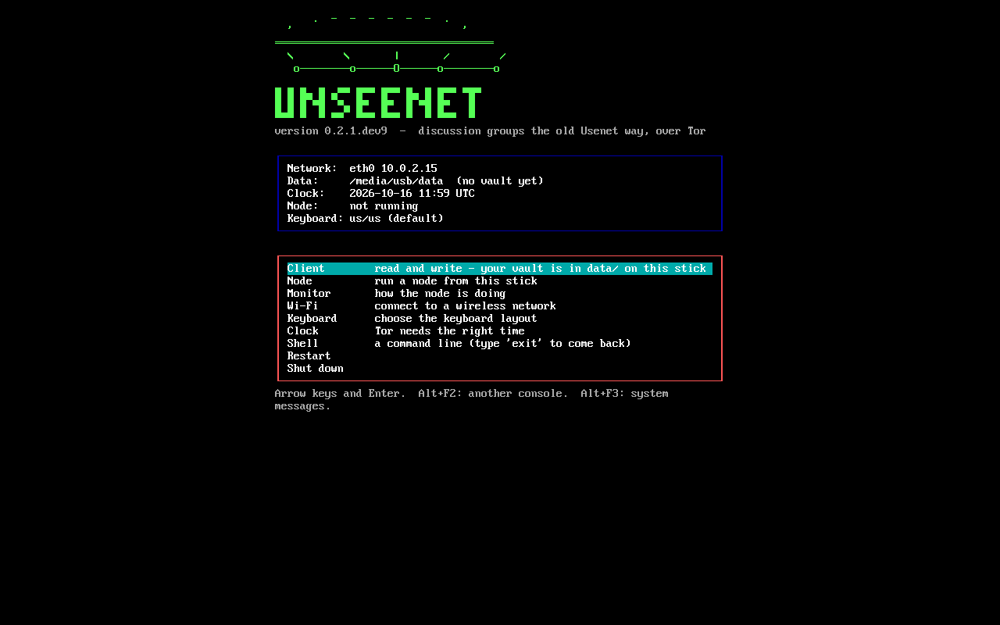

<p align="center">
  <picture>
    <source media="(prefers-color-scheme: dark)" srcset="https://raw.githubusercontent.com/unseenet/unseenet/main/assets/logo-dark.svg">
    
  </picture>
</p>

<h1 align="center">unseenet-bootable</h1>

<p align="center"><b>Boot straight into Unseenet - from a USB stick, an SD card or a disk.</b><br>
Runs from memory, touches nothing on the computer, and the same stick works as a portable on a running one.</p>

<p align="center">
  <a href="https://github.com/unseenet/unseenet-bootable/releases"></a>
  <a href="https://github.com/unseenet/unseenet-bootable/actions/workflows/build.yml"></a>
  <a href="LICENSE"></a>
</p>

> **Pre-alpha.** Nothing is stable yet, and Unseenet has not had a security
> review. Do not rely on it to protect anyone yet.

<table align="center"><tr>
<td align="center"><br><sub><b>Bootable · Terminal</b>: the menu</sub></td>
<td align="center"><br><sub><b>Bootable · Graphical</b>: the client full screen</sub></td>
</tr></table>

## What it is

A bootable [Unseenet](https://unseenet.org): Alpine Linux, Tor and the
client on one stick. Boot a computer from it and Unseenet runs from memory -
nothing is written to the computer's disk, and when you pull the stick out
nothing is left. On a computer that is already running, the same stick opens
like the [portable builds](https://github.com/unseenet/unseenet-portable),
with the same `data/` folder, so your keys and groups come along either way.

| | |
|---|---|
| **Bootable · Terminal** | a menu with the terminal client, a node of your own, the node monitor, Wi-Fi, keyboard and clock |
| **Bootable · Graphical** | the graphical client full screen, with network, keyboard and power at the top |

## Get it

From the [releases](https://github.com/unseenet/unseenet-bootable/releases) (or the
newest [development images](https://github.com/unseenet/unseenet-bootable/releases/tag/dev)):
`unseenet-<version>-x86_64.img.xz` (terminal) or
`unseenet-gui-<version>-x86_64.img.xz` (graphical). Check it against
`SHA256SUMS.txt` from the same release.

Write it to a stick of 2 GB or more (4 GB memory for the graphical one) -
**everything on the stick is erased** - with
[balenaEtcher](https://etcher.balena.io/), [Rufus](https://rufus.ie/) (DD
mode) or:

```bash
xzcat unseenet-<version>-x86_64.img.xz | sudo dd of=/dev/sdX bs=4M status=progress conv=fsync
```

Then restart with the stick in and choose it in the boot menu (often **F12**,
F11, F9, Esc; on a Mac hold **Option**). BIOS and UEFI both work; turn
**Secure Boot** off, as the image is not signed by Microsoft. The stick
updates itself from the menu: it fetches the newest signed image over Tor
and keeps `data/`.

**The full guide:** [Bootable](https://unseenet.org/bootable/) - writing it,
booting, the menu, your data, updating.

## How it works

This repository holds no client code. Each night, after the
[portable builds](https://github.com/unseenet/unseenet-portable), its
workflow takes their USB zips, builds the terminal and the graphical image
(Alpine from memory, the portable builds on the same FAT partition), and
**boots each in QEMU, BIOS and UEFI, where its self-test must pass** -
Tor connecting included. It only builds when the zips or the image tools
changed; the images are signed with the build repositories' release key and
announced in `unseenet.releases`, so sticks hear of them through the network.

| When | What |
|---|---|
| each night, after unseenet-portable | only if the zips or the image tools changed; replaces `dev` |
| by hand | *Run workflow*: `publish`, `force`, and where the zips come from |
| a pull request | the images as artifacts |

## Releases

Each release of [unseenet-portable](https://github.com/unseenet/unseenet-portable)
is made here too, with the same tag and parts: `follow-portable` checks once a
day, tags it and builds it. A newer Tor makes a post-release there
(`vX.Y.Z.postN`) and so here; since the images take tor from Alpine's package,
the build waits up to 7 days for Alpine to have the newest stable tor
(`tools/tor_versions.py check`). The maintainer signs `SHA256SUMS.txt`
afterwards.

## Develop

The image tools are here: `tools/image/` builds the terminal image and
`tools/image-graphical/` the graphical one, each in an Alpine container, from
checkouts of the core (and the graphical client) given as arguments. Coming on this
base: a node mode with an encrypted partition and a setup menu
(unseenet#551), and a Raspberry Pi image that runs a node (unseenet#552).

## Versions and releases

Images are versioned as the core they carry, like the portable builds
(`0.6.0`, a rebuild `0.6.0.post1`), and are released together with them;
the maintainer signs a release's `SHA256SUMS.txt` with the project key.
Notes are in [CHANGELOG.md](CHANGELOG.md).

## Part of Unseenet

| Repository | What it is |
|---|---|
| [unseenet](https://github.com/unseenet/unseenet) | The protocol (UN-RFCs), the core library, the node and the command-line client |
| [unseenet-tui](https://github.com/unseenet/unseenet-tui) | The terminal client |
| [unseenet-gui](https://github.com/unseenet/unseenet-gui) | The graphical client - in a window, booted, or in a browser |
| [unseenet-portable](https://github.com/unseenet/unseenet-portable) | Builds the portable clients, Terminal and Graphical, with Tor inside |
| [unseenet-bootable](https://github.com/unseenet/unseenet-bootable) | Builds the bootable images, Terminal and Graphical |
| [unseenet-docs](https://github.com/unseenet/unseenet-docs) | The site [unseenet.org](https://unseenet.org) |
| [unseenet-entrance](https://github.com/unseenet/unseenet-entrance) | Web entrances: the graphical client in an ordinary browser |
| [unseenet-gateway](https://github.com/unseenet/unseenet-gateway) | Gateways to other networks: Usenet, Nostr, Matrix |
| [unseenet-bots](https://github.com/unseenet/unseenet-bots) | Bots that keep channels filled with current content |
| [unseenet-helpbot](https://github.com/unseenet/unseenet-helpbot) | The bot that answers questions in `unseenet.help` |
| [unseenet-stats](https://github.com/unseenet/unseenet-stats) | Statistics for the network |
| [unseenet-mcp](https://github.com/unseenet/unseenet-mcp) | An MCP server, so a language model can read and post as you (planning) |
| [unseenet-demo](https://github.com/unseenet/unseenet-demo) | Demo people, feeds and sites, made with the command-line client |

## License

[Apache License 2.0](LICENSE). The Unseenet logo: CC BY 4.0.
